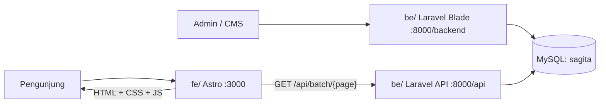

# Sagita Wedding

Panduan lengkap untuk developer baru: arsitektur, instalasi, konfigurasi, alur kerja, dan perintah yang sering dipakai.

- **Backend:** Laravel 13 · PHP 8.3 · MySQL · Blade · Tailwind 3 · Vite
- **Frontend:** Astro 7 · TypeScript · Tailwind 4 · @astrojs/node
- **Port:** `3000` (website publik) · `8000` (panel admin & API)

## Daftar Isi

- [1. Gambaran Umum](#1-gambaran-umum)
- [2. Teknologi yang Dipakai](#2-teknologi-yang-dipakai)
- [3. Struktur Direktori](#3-struktur-direktori)
- [4. Prasyarat](#4-prasyarat)
- [5. Instalasi dan Menjalankan](#5-instalasi-dan-menjalankan)
- [6. Konfigurasi Lintas Aplikasi](#6-konfigurasi-lintas-aplikasi)
- [7. Fitur Utama](#7-fitur-utama)
- [8. Ringkasan API](#8-ringkasan-api)
- [9. Alur Kerja dan Aturan Kerapian](#9-alur-kerja-dan-aturan-kerapian)
- [10. Perintah Sehari-hari](#10-perintah-sehari-hari)
- [11. Troubleshooting](#11-troubleshooting)
- [12. Catatan untuk Developer Baru](#12-catatan-untuk-developer-baru)
- [13. Deployment Produksi](#13-deployment-produksi)

---

## 1. Gambaran Umum

Proyek ini adalah **monorepo** dengan dua aplikasi yang berjalan terpisah:

| Folder | Peran                            | Teknologi                                       | Port default |
| ------ | -------------------------------- | ----------------------------------------------- | ------------ |
| `be/`  | Backend + panel admin + JSON API | Laravel 13 (PHP 8.3), Blade, Tailwind 3, Vite   | `8000`       |
| `fe/`  | Website publik (front-end)       | Astro 7, TypeScript, Tailwind 4, @astrojs/node | `3000`       |

Alurnya:



Poin penting:

- **Backend hanya menyajikan panel admin dan API.** Halaman publik disajikan oleh Astro.
- **Frontend memakai pola BFF (Backend for Frontend)**: setiap halaman publik mengambil semua datanya lewat **satu** request `GET /api/batch/{page}` ke Laravel, bukan puluhan request per resource.
- Kedua aplikasi **harus berjalan bersamaan** agar website publik menampilkan data.
- Repo masih dalam masa transisi branding: sebagian konten/kode masih memakai nama **Sagita Wedding / yoga** (kelas, vendor, jadwal), sementara migrasi terbaru mengarah ke **venue & vendor wedding** (`studios` → `venues`, `specializations` → `vendors_categories`).

---

## 2. Teknologi yang Dipakai

### Backend (`be/`)

- PHP `^8.3`, Laravel `^13.0`
- Laravel Breeze (autentikasi), Spatie `laravel-permission` (RBAC), Socialite (Google OAuth)
- Maatwebsite Excel, DomPDF (ekspor), `anhskohbo/no-captcha`, `ralphjsmit/laravel-seo`, Guzzle
- Vite 5 + Tailwind CSS 3 + Alpine.js + Axios (aset panel admin)
- PHPUnit + Mockery, Laravel Pint

### Frontend (`fe/`)

- Node.js **`>=22`** (wajib), TypeScript, Astro 7, `@astrojs/node`
- Tailwind CSS 4, `sanitize-html`, CSP nonce + rate limit di `src/middleware.ts`
- Vitest (test), Biome (lint/format), Astro SSR adapter

---

## 3. Struktur Direktori

```text
sagita-wedding/
├── be/                              # Laravel (admin + API)
│   ├── app/
│   │   ├── Http/Controllers/
│   │   │   ├── Admin/               # CRUD panel admin
│   │   │   ├── Api/                 # endpoint JSON publik (BatchController, dll.)
│   │   │   ├── Auth/                # Breeze + Google
│   │   │   └── ManagementAccess/    # user, role, permission, menu, route
│   │   ├── Http/Middleware/         # VerifyApiKey, ApiSecurityHeaders, AutoLogoutInactive, ...
│   │   ├── Models/                  # Eloquent model
│   │   └── Services/Security/       # deteksi anomali, brute force, dll.
│   ├── bootstrap/app.php            # daftar middleware & alias (baca ini dulu!)
│   ├── config/                      # database, cors, frontend, security, ...
│   ├── database/
│   │   ├── migrations/              # 63 migrasi
│   │   ├── seeders/                 # 11 file seeder (10 dipanggil DatabaseSeeder)
│   │   └── factories/
│   ├── resources/views/             # Blade panel admin
│   ├── routes/{web,api,auth,console}.php
│   ├── sagita (3).sql               # dump database MariaDB (55 tabel)
│   └── .env / .env.example
└── fe/                              # Astro SSR (website publik)
    ├── astro.config.mjs
    ├── src/
    │   ├── middleware.ts            # nonce CSP, origin check, rate limit, i18n, minify
    │   ├── pages/                   # rute halaman + src/pages/api/*
    │   ├── components/ layouts/     # UI reusable
    │   ├── lib/
    │   │   ├── config/              # env tervalidasi, locale (en|id)
    │   │   ├── services/            # apiClient, batchService, sita*, siteIdentity
    │   │   ├── data/                # data statis site/nav/kontak + translasi
    │   │   ├── browser/             # module interaksi browser
    │   │   └── utils/               # validate.ts, sanitize.ts, logger.ts
    │   └── styles/                  # sumber Tailwind
    ├── public/css/                  # output.css hasil build
    ├── tests/
    ├── scripts/check-assets.mjs
    └── .env.example
```

---

## 4. Prasyarat

- **XAMPP** (Apache + MySQL/MariaDB + PHP 8.3) atau PHP 8.3 & MySQL/MariaDB terpisah
- **Composer** (untuk `be/`)
- **Node.js >= 22** + npm (untuk kedua folder; `be/` butuh Node untuk Vite)
- Ekstensi PHP: `pdo_mysql`, `mbstring`, `xml`, `curl`, `zip`, `gd`, `dom`, `fileinfo`
- Git

> [!TIP]
> Di XAMPP, jalankan **Apache** dan **MySQL** melalui Control Panel sebelum menjalankan aplikasi.

---

## 5. Instalasi dan Menjalankan

> [!NOTE]
> Ringkasnya: jalankan backend di terminal 1 (`php artisan serve`) dan frontend di terminal 2 (`npm run dev`). Keduanya harus aktif bersamaan.

### 5.1 Backend (`be/`)

```bash
cd be
composer install
cp .env.example .env
php artisan key:generate
```

Edit `be/.env` bila perlu (default `.env.example` sudah memakai MySQL/XAMPP database `sagita`):

```dotenv
APP_NAME="Sagita Wedding"
APP_ENV=local
APP_DEBUG=false
APP_URL=http://localhost:8000

DB_CONNECTION=mysql
DB_HOST=127.0.0.1
DB_PORT=3306
DB_DATABASE=sagita
DB_USERNAME=root
DB_PASSWORD=

SESSION_DRIVER=database
SESSION_COOKIE=sagita_session
SESSION_SECURE_COOKIE=false   # true di produksi (HTTPS)
CACHE_STORE=database
QUEUE_CONNECTION=database

FRONTEND_URL=http://localhost:3000
CORS_ALLOWED_ORIGINS=http://localhost:3000,http://127.0.0.1:3000
FRONTEND_API_KEY=secret-bersama-anda
```

Siapkan database **pilih salah satu**:

**Opsi A — Import dump (paling cepat, data lengkap):**

```bash
# Buat database bernama `sagita` di phpMyAdmin, lalu import file "sagita.sql"
php artisan migrate          # pastikan tidak ada migrasi yang tertinggal
```

**Opsi B — Migrasi + seeder dari kosong:**

```bash
php artisan migrate --seed
```

Lanjutkan:

```bash
npm install
npm run dev            # atau: npm run build  (untuk produksi)
php artisan storage:link
php artisan serve      # http://localhost:8000
```

Karena `QUEUE_CONNECTION=database`, jalankan worker agar pengingat `OrderBalanceDueNotification` terkirim:

```bash
php artisan queue:work --tries=3 --stop-when-empty
```

Untuk produksi, jalankan worker tersebut sebagai layanan Supervisor/systemd.

### 5.2 Frontend (`fe/`)

```bash
cd ../fe                       # kembali ke root, lalu masuk ke folder fe
cp .env.example .env
npm install
npm run build:css      # opsional; hasil build sudah ikut repo, jalankan setelah ubah CSS
npm run dev            # http://localhost:3000
```

Isi `fe/.env`:

```dotenv
BACKEND_URL=http://localhost:8000
API_PREFIX=v1
API_KEY=secret-bersama-anda      # HARUS sama dengan FRONTEND_API_KEY di be/.env
SITE_URL=http://localhost:3000
GOOGLE_AUTH_URL=http://localhost:8000/auth/google
SESSION_COOKIE_NAME=sagita_session # HARUS sama dengan SESSION_COOKIE di be/.env
WHATSAPP_NUMBER=6281380760095
PORT=3000
ASSET_V=20261120t
HTML_MINIFY=1
```

Untuk mode produksi: `npm run build` lalu `npm start`.

### 5.3 Akses setelah berjalan

| URL                                                 | Keterangan                |
| --------------------------------------------------- | ------------------------- |
| `http://localhost:3000`                             | Website publik            |
| `http://localhost:8000/backend/dashboard`           | Panel admin (butuh login) |
| `http://localhost:8000/auth/login`                  | Login admin               |
| `http://localhost:8000/api/v1/batch/home`              | Contoh respons API        |
| `http://localhost:3000/healthz` / `/readyz`         | Health check              |
| `http://localhost:3000/sitemap.xml` / `/robots.txt` | SEO                       |

<details>
<summary><strong>Akun setelah seed</strong> (klik untuk membuka)</summary>

Seeder sengaja **tidak membuat akun admin/user dengan password statis**. Setelah migrasi + seed, daftar lewat `http://localhost:8000/register`, lalu berikan role awal lewat Tinker karena Management Access hanya bisa dibuka admin:

```php
$user = \App\Models\User::where('email', 'email-yang-didaftarkan')->firstOrFail();
$user->assignRole('super-admin');
```

Seeder hanya membuat satu author konten internal dengan password random yang tidak disimpan atau ditampilkan.

</details>

Seeder yang dijalankan `DatabaseSeeder`: `Permission`, `Role`, `Menu`, `Route`, `Security`, `Membership`, `BannerMedia`, `WebsiteIdentity`, `EmailSetting`, `Content`.

---

## 6. Konfigurasi Lintas Aplikasi

> [!IMPORTANT]
> `API_KEY` di `fe/.env` **harus identik** dengan `FRONTEND_API_KEY` di `be/.env`. Jika berbeda, semua request `/api/v1/*` akan ditolak.

| Variabel                                    | Lokasi    | Aturan                                                                                                |
| ------------------------------------------- | --------- | ----------------------------------------------------------------------------------------------------- |
| `FRONTEND_API_KEY`                          | `be/.env` | Shared secret untuk middleware `VerifyApiKey` pada semua `/api/v1/*`                                     |
| `API_KEY`                                   | `fe/.env` | **Nilainya harus identik** dengan `FRONTEND_API_KEY`                                                  |
| `BACKEND_URL` + `API_PREFIX`                | `fe/.env` | Base URL Laravel + prefix API, contoh `http://localhost:8000` + `v1`                                  |
| `SESSION_COOKIE`                            | `be/.env` | Nama cookie session Laravel; default `sagita_session`                                                 |
| `SESSION_COOKIE_NAME`                       | `fe/.env` | **Nilainya harus identik** dengan `SESSION_COOKIE`                                                    |
| `SESSION_SECURE_COOKIE`                     | `be/.env` | `true` di produksi HTTPS agar cookie tidak dikirim lewat HTTP                                        |
| `FRONTEND_URL`                              | `be/.env` | Dipakai untuk canonical URL & redirect setelah OAuth (host harus persis, bukan prefix)                 |
| `CORS_ALLOWED_ORIGINS`                      | `be/.env` | Harus mengizinkan origin `fe` (`localhost:3000`, `127.0.0.1:3000`)                                    |
| `GOOGLE_CLIENT_ID` / `GOOGLE_CLIENT_SECRET` | `be/.env` | Kredensial OAuth Google Cloud Console                                                                 |
| `GOOGLE_REDIRECT_URL`                       | `be/.env` | Harus **persis** sama dengan Authorized Redirect URI di Google. `localhost` ≠ `127.0.0.1` bagi Google |
| `GOOGLE_AUTH_URL`                           | `fe/.env` | Host harus konsisten dengan redirect URL di atas                                                      |
| `NOCAPTCHA_SITEKEY` / `NOCAPTCHA_SECRET`    | `be/.env` | Captcha form kontak                                                                                   |
| `MANUAL_BANK_*`, `MANUAL_ADMIN_WA`          | `be/.env` | Pembayaran transfer manual & nomor WA admin                                                           |
| `ASSET_V`                                   | `fe/.env` | Cache-buster aset (`?v=`), naikkan setelah deploy aset statis                                         |
| `HTML_MINIFY`                               | `fe/.env` | `1` = HTML di-minify; `0` = readable saat debug                                                       |

> [!WARNING]
> Jangan pernah commit file `.env` (keduanya sudah ada di `.gitignore`). Gunakan `.env.example` sebagai referensi.

Untuk konfigurasi server Linux produksi, lihat [panduan deployment produksi](deploy/production/README.md).

---

## 7. Fitur Utama

### Website publik (`fe/`)

- Beranda (testimoni, venue, paket, artikel), halaman Tentang dengan statistik live
- Katalog venue & vendor wedding, katalog/detail paket pernikahan
- Blog/artikel + kategori + artikel terkait, event/workshop
- Galeri (dari banner/media admin), halaman statis via CMS (`/pages/:slug`)
- Form konsultasi + captcha & FAQ
- i18n Indonesia/Inggris melalui `?lang=id` (cookie)
- Modal booking & tombol WhatsApp mengambang
- SEO: canonical/hreflang, JSON-LD (Organization, WebSite, LocalBusiness, WebPage, BlogPosting, BreadcrumbList), OG 1200×630, sitemap dengan `lastmod` dari backend, robots.txt, analytics setelah consent, `healthz`/`readyz`
- Login Google (session bersama dengan backend)

> [!NOTE]
> `POST /api/booking` kini menyimpan permintaan sebagai leads konsultasi via backend `/api/contact`. `POST /api/newsletter` menyimpan alamat email ke tabel `newsletter_subscribers` lewat backend `/api/newsletter`; email duplikat dibalas sukses dengan `duplicate: true`.

### Panel admin (`be/`)

- Dashboard + global search
- RBAC: user, role, permission, route, menu group & menu item
- CMS: artikel, kategori, halaman, event, banner, album, FAQ, testimoni, polling, file download
- Editor identitas website (singleton) & venue/vendor category
- Kelas, jadwal kelas, booking kelas, scan QR/ID, check-in, pembatalan, rating, pengingat
- Paket, order, pembayaran (transfer manual + verifikasi bukti), laporan & ekspor PDF
- Notifikasi, tampilan member/mobile
- Keamanan: login activity, failed login, lockout, audit log, proteksi brute force, deteksi anomali, auto-logout setelah 30 menit idle

---

## 8. Ringkasan API

Endpoint di bawah ini diawali `/api` dan melewati middleware `ApiSecurityHeaders`, `throttle`, dan `VerifyApiKey` (kirim header API key sesuai konfigurasi). Endpoint sesi (`/auth/*`) dijelaskan terpisah di bawah.

### Endpoint batch (dipakai halaman publik)

`GET /api/batch/{page}`, dengan `{page}` salah satu dari:

`home`, `venues`, `about`, `blog`, `blog-detail`, `packages`, `package-detail`, `vendors`, `events`, `gallery`, `contact`, `faq`, `page-detail`

Contoh parameter: `?slug=...`, `?search=...`, `?filter=...`, `?sort=...`, `?date_from=...`, `?date_to=...`, `?page=...`, `?per_page=...` (tergantung halaman). Respons umum:

```json
{
  "status": "success",
  "message": "Batch data retrieved successfully",
  "page": "home",
  "data": { "...": "..." }
}
```

Batch memakai ETag berbasis `BatchVersionService` + `Cache-Control: no-cache, must-revalidate`. Versi naik otomatis saat model konten (artikel, venue, paket, banner, FAQ, dll.) ditulis dari admin, sehingga ETag berubah dan perubahan langsung tampil. Jika ETag masih sama, backend langsung membalas 304 tanpa menjalankan query agregasi. FE menyimpan body per `page + query`, mengirim `If-None-Match` pada setiap akses halaman, dan menggabungkan request bersamaan (single-flight) untuk kunci yang sama. ETag juga menyertakan bucket menit supaya konten terjadwal (`scheduled_at`, `published_at`) tetap terlihat maksimal 1 menit setelah waktunya; perubahan dari admin langsung terlihat tanpa menunggu menit berikutnya.

### Endpoint individual (sebagian)

```text
GET  /api/faqs                 /api/testimonials       /api/banners
GET  /api/categories           /api/website-identity   /api/site-stats
GET  /api/articles             /api/articles/{slug}    /api/articles/category/{slug}
GET  /api/pages                /api/pages/{slug}
GET  /api/events               /api/events/{slug}
GET  /api/vendors              /api/packages           /api/packages/{slug}
GET  /api/staff                /api/pegawai            (alias legacy)
GET  /api/contact/captcha
POST /api/contact
POST /api/newsletter
POST /api/analytics/visits
```

`GET /api/faqs` menerima `?kategori=<nama kategori>` dan mengembalikan `data` berisi `uuid`, `kategori`, `question`, `answer` serta `meta` berisi `total`, `kategori`, dan daftar `categories`.

Endpoint internal Astro (dipanggil browser) ada di `fe/src/pages/api/`, antara lain `/api/contact/captcha`, `/api/contact`, dan passthrough `/api/batch/{page}`. Endpoint lama `/api/classes`, `/api/class-schedules`, dan `/api/batch/schedules` sengaja membalas `410 Gone`.

Error API memakai amplop konsisten: `{ "success": false, "status": "error", "message": "...", "errors": { ... } }` (field `errors` hanya untuk 422). `POST /api/contact` punya honeypot `website`; `POST /api/analytics/visits` dibatasi 30/menit/IP + 10/menit/visitor dan deduplikasi per menit.

Endpoint sesi untuk frontend: `GET /auth/me`, `POST /auth/me/logout`, `GET /auth/google` (di backend, tanpa prefiks `/api`).

---

## 9. Alur Kerja dan Aturan Kerapian

### Menambah halaman publik

1. Tambah data di `BatchController::show()` (`be/app/Http/Controllers/Api/BatchController.php`) bila halaman butuh data baru.
2. Buat file Astro di `fe/src/pages/` yang memanggil `getPageBatch('nama-page')`.
3. Pakai component/layout yang sudah ada di `fe/src/components/` dan `fe/src/layouts/`.
4. Update daftar URL statis di `fe/src/pages/sitemap.xml.ts` bila perlu, dan beri `breadcrumbs` jika halaman punya breadcrumb terlihat.
5. Sediakan `ogImage` 1200×630 bila gambar default tidak relevan.
6. Jalankan `npm run typecheck && npm run lint && npm test` di `fe/`.

### Aturan penting di `fe/`

- **Tidak ada URL/nomor hardcode** di `.astro`, module browser, dan services — pakai `contactLinks` / `env` / `site`.
- Blok UI yang dipakai lebih dari satu halaman wajib jadi component/layout.
- Semua input (slug, query, body POST) wajib lewat `src/lib/utils/validate.ts`.
- HTML dari CMS wajib melewati `sanitizeRichHtml()` sebelum `set:html`; atribut `style` tidak diizinkan.
- Inline script wajib memakai nonce dari `Astro.locals.nonce`; GA ID dan JSON inline sudah divalidasi/di-escape.
- Query ke backend wajib lewat `buildQuery(params, whitelist)` di `src/lib/services/apiClient.ts`.
- Halaman publik wajib mengambil data lewat `getPageBatch(page)`, bukan memanggil service per resource satu per satu. `getPageBatch` sudah menangani cache ETag + single-flight; jangan membungkusnya dengan cache TTL karena bisa membuat konten admin basi.
- Tambah bahasa baru: update `src/lib/config/locales.ts` **dan** `src/lib/data/translations.ts`.

### Aturan penting di `be/`

- Endpoint baru masuk `routes/api.php` (publik) atau `routes/web.php` (admin).
- Middleware global & alias ada di `bootstrap/app.php` — baca sebelum menambah proteksi.
- Panel admin memakai `route.permission` (Spatie) + auto-logout idle; daftar menu/route diatur lewat Management Access.
- Gunakan `php artisan make:controller/model/request`, lalu daftarkan route, migrasi, dan permission bila perlu.
- Model konten baru yang dipakai `/api/batch/{page}` wajib masuk `BatchVersionService::WATCHED_MODELS` agar ETag berubah saat datanya ditulis.
- Format kode PHP dengan `vendor/bin/pint`.

---

## 10. Perintah Sehari-hari

### Frontend (`fe/`)

```bash
npm run dev          # Astro dev server (:3000)
npm run build:css    # Tailwind -> public/css/output.css
npm run watch:css    # watch CSS
npm run typecheck    # tsc
npm run lint         # Biome check
npm run lint:fix     # Biome check + perbaikan otomatis
npm test             # Vitest (service dimock, tidak butuh MySQL)
npm run test:server  # build + integration test server Astro asli
npm run test:a11y    # Vitest a11y
npm run test:golden  # evaluasi query golden Sita
npm run build        # lint + typecheck + build CSS + Astro build
npm run perf:assets  # build + cek budget aset di dist/client
npm start            # NODE_ENV=production node dist/server/entry.mjs
```

### Backend (`be/`)

```bash
php artisan serve             # development server (:8000)
php artisan migrate           # jalankan migrasi
php artisan migrate --seed    # migrasi + seeder
php artisan db:seed           # seeder saja
php artisan storage:link      # symlink public/storage
php artisan test              # PHPUnit
vendor/bin/pint               # format kode PHP (di Windows: vendor\bin\pint.bat)
npm run dev                   # aset Vite panel admin (atau: npm run build)
```

---

## 11. Troubleshooting

| Gejala                                       | Penyebab umum & solusi                                                                                                           |
| -------------------------------------------- | -------------------------------------------------------------------------------------------------------------------------------- |
| Halaman publik kosong / error fetch          | Backend belum jalan, atau `BACKEND_URL` salah. Cek `http://localhost:8000/api/v1/batch/home`.                                           |
| Respons API `401/403` dari `/api/v1/*`          | `API_KEY` (fe) tidak sama dengan `FRONTEND_API_KEY` (be). Samakan, lalu restart kedua server.                                    |
| Error CORS di browser                        | `CORS_ALLOWED_ORIGINS` belum memasukkan origin `fe`, atau port berbeda.                                                          |
| Login Google gagal / `redirect_uri_mismatch` | `GOOGLE_REDIRECT_URL` tidak persis sama dengan Authorized Redirect URI di Google Console. Perhatikan `localhost` vs `127.0.0.1`. |
| Gambar upload tidak tampil                   | Jalankan `php artisan storage:link` dan pastikan `FILESYSTEM_DISK=public` / izin folder `storage`.                               |
| Tabel tidak ada setelah import SQL           | Pastikan database bernama `sagita` dan `DB_DATABASE` di `.env` sesuai, lalu `php artisan migrate`.                               |
| CSS/JS tidak berubah setelah deploy          | Naikkan `ASSET_V` di `fe/.env`, lalu `npm run build` dan restart proses Astro.                                                    |
| Error `Class "PDO" not found` / ekstensi PHP | Aktifkan ekstensi PHP yang dibutuhkan di `php.ini` XAMPP, restart Apache.                                                        |
| Port 3000/8000 sudah dipakai                 | Ubah `PORT` di `fe/.env` atau jalankan `php artisan serve --port=8080` (sesuaikan `BACKEND_URL`).                                    |

---

## 12. Catatan untuk Developer Baru

- Mulai dari `be/bootstrap/app.php` untuk memahami middleware, lalu `be/routes/api.php` dan `fe/src/pages/` untuk memahami alur data.
- Perubahan konten di panel admin langsung tampil di website publik (batch API tanpa cache konten).
- `fe/README.md` berisi aturan kerapian yang lebih rinci khusus front-end; `be/README.md` masih berisi template default Laravel.
- Seluruh file `.env` bersifat lokal dan tidak boleh masuk Git.

---

## 13. Deployment Produksi

Konfigurasi dan langkah instalasi native Linux (Apache + PHP-FPM + MySQL + Node/systemd), termasuk template environment, vhost, worker queue, scheduler, HTTPS, dan inisialisasi database tersedia di [deploy/production/README.md](deploy/production/README.md). File di [deploy/apache/](deploy/apache/) hanya untuk host lokal `.test`.
